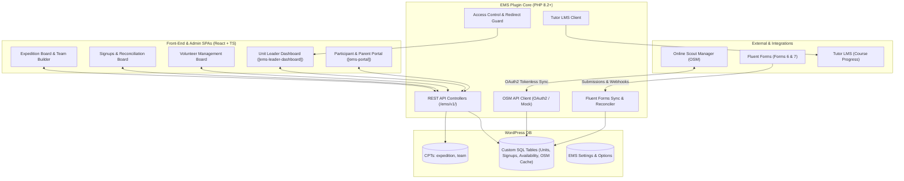

# Expedition Management System (EMS)

A comprehensive WordPress plugin for coordinating Duke of Edinburgh (DofE) expeditions, managing teams and routes, tracking training compliance, and reconciling participant registrations across South East Scotland.

---

## 1. Overview & Purpose

The **Expedition Management System (EMS)** serves as the central operational hub for DofE expedition management. It connects and synchronizes four key systems:

1. **Online Scout Manager (OSM)** — The primary authority for explorer identity, unit/patrol memberships, event schedules, and attendance.
2. **Fluent Forms** — Public-facing web registration forms for parent-led **Participation Place** registrations (Form 6) and **Expedition Preferences** submissions (Form 7).
3. **Tutor LMS** — The e-learning platform hosting pre-expedition safety and navigation training modules.
4. **EMS Admin & Public Portals** — React-powered SPAs for team building, first aid safety verification, volunteer coordination, route approval, and unit leader tracking.

---

## 2. How the Plugin Works



### Key Architectural Concepts

- **Identity Anchor (`scout_id`)**: The immutable identifier for young people is the Online Scout Manager `scout_id` stored in `ems_osm_explorers`. WordPress user accounts are **not** created during data syncs; WP user IDs are linked dynamically upon first login via OpenID Connect (OIDC).
- **Tokenless OSM Security**: Administrative syncs use personal OAuth2 authorization codes that are exchanged in memory, executed, and **immediately discarded**. OAuth access tokens are never saved to the database.
- **Hybrid Data Storage**: High-level entities (`expedition`, `team`) use WordPress Custom Post Types for standard admin filtering and WP-CLI compatibility. High-frequency relational data (team members, signups, volunteer availability, patrol linkages, audit logs) reside in dedicated custom SQL tables created via `Table_Installer` with `$wpdb->prefix . 'ems_*'`.
- **Decoupled React Architecture**: Admin boards and front-end portals are built with React and TypeScript, communicating with the WordPress backend exclusively through authenticated REST controllers (`/wp-json/ems/v1/`).

---

## 3. Database Architecture

### Custom Post Types (CPTs)

| CPT Slug | Post Parent | Description |
|---|---|---|
| `expedition` | `0` (Top-level) | Represents a training, practice, or qualifying expedition with dates, locations, transport mode, Leader-in-Charge (LiC), and route deadlines. |
| `team` | `expedition` Post ID | Represents a walking, cycling, or paddling team (typically 4–7 members). Tracks team codes (e.g. `H-SP1-1`), GPX route files, route cards, and LiC feedback. |

### Relational Database Tables

| Table | Purpose & Key Columns |
|---|---|
| `ems_osm_explorers` | Synced cache of OSM members: `scout_id (UNIQUE)`, `first_name`, `last_name`, `email`, `parent_email`, `patrol`, `first_aid_level`, `dofe_number`. |
| `ems_units` | Master directory of Explorer Scout Units: `unit_id (UNIQUE)`, `district`, `name`, `short_code (UNIQUE)`, `leader_email`. |
| `ems_unit_patrols` | Maps OSM sections/patrols to master units: `unit_id`, `section_id`, `patrol_id (UNIQUE)`, `name`, `active`. |
| `ems_participant_signups` | DofE Participation Place registrations (Form 6): `scout_id`, `parent_user_id`, `unit_id`, `dofe_level`, `signup_status`, `payment_status`. |
| `ems_expedition_signups` | Expedition preferences (Form 7): `scout_id`, `parent_user_id`, `unit_id`, `dofe_level`, `expedition_preferences`, `first_aid_status`. |
| `ems_team_members` | Team membership links: `team_post_id`, `scout_id`, `user_id`, `added_by`, `added_at`. |
| `ems_volunteers` | Registered adult helpers: `osm_user_id`, `first_name`, `last_name`, `email`, `dbs_number`, `qualifications`. |
| `ems_volunteer_availability` | Date-by-date staffing coverage: `volunteer_id`, `expedition_post_id`, `date`, `overnight`, `confirmed`. |
| `ems_route_submissions` | Versioned route cards & GPX uploads: `team_post_id`, `version`, `file_type`, `wp_media_id`, `status`, `feedback`. |
| `ems_audit_logs` | Security & operational action logs: `user_id`, `action`, `target_scout_id`, `ip_address`, `timestamp`. |

---

## 4. User Roles & Access Control

EMS registers four specialized roles managed via `Role_Manager`:

1. **`ems_explorer`**: Assigned to participants logging in with their OSM member credentials. Grants access to Tutor LMS training courses and the Participant Portal for route uploads.
2. **`ems_parent`**: Assigned to parents and guardians. Allows viewing linked children, completing registration forms, and reviewing expedition status.
3. **`ems_leader`**: Assigned to unit leaders and Leaders-in-Charge (LiC). Grants access to the **Unit Leader Dashboard** (`[ems-leader-dashboard]`), route review pipelines, and expedition rosters.
4. **`administrator`**: WordPress administrators with complete access to planning boards, settings, and sync tools.

### Access Control & Routing Features

- **Page-Level Protection (`Access_Control_Guard`)**: In **EMS → Settings → Access Control**, administrators can restrict any WordPress page to specific role(s). Unauthorized guests are prompted to log in; unauthorized roles receive a styled 403 Access Denied page.
- **Tutor LMS Route Guard**: Intercepts Tutor LMS dashboard and course pages, restricting them exclusively to participants (`ems_explorer`).
- **Leader Onboarding & Post-Password-Reset Redirection**:
  - Unit leaders receive an invitation email containing a one-time password setup link.
  - When the leader submits their password on `wp-login.php?action=rp`, WordPress (`after_password_reset`) **automatically signs them in**, updates `ems_last_login_at`, and **redirects them straight to the Leader Dashboard**.
  - Subsequent logins via `wp-login.php` (`login_redirect`) automatically route `ems_leader` accounts directly to the Leader Dashboard rather than `wp-admin`.

---

## 5. Front-End Portals & Shortcodes

| Shortcode | Primary Users | Purpose |
|---|---|---|
| `[ems-portal]` | Parents, Explorers, Leaders | **Unified Portal SPA**: Dynamically adapts based on user role to show child profiles, expedition statuses, online training progress, and route upload/feedback tools. |
| `[ems-leader-dashboard]` | Unit Leaders (`ems_leader`) | **Unit Leader Dashboard SPA**: Read-only overview of explorer registrations grouped by unit and sorted alphabetically. Displays DofE levels, participant place and expedition preference completion checkmarks, expedition transport modes, and OSM sync indicators. Excludes sensitive medical and contact data. |
| `[ems-volunteer-signup]` | Adult Volunteers | **Volunteer Cover Board**: Lets helpers view expedition calendars and register for specific checkpoint dates and overnight stays. |
| `[ems_signup_banner]` | Form Visitors | **OIDC Action Banner**: Prompt placed at the top of signup forms encouraging parents to log in via OSM to auto-fill child and unit fields. |

---

## 6. WordPress Admin Screens

1. **Expedition Board (`ems-expedition-board`)**: Interactive team planner with drag-and-drop team allocation, team size indicators (4–7 official range), first aid compliance warnings, and unassigned participant pools.
2. **Signups Board (`ems-signups`)**: Reconciles public Fluent Forms submissions against synced OSM explorer records. Provides side-by-side comparison, auto-matching, manual reconciliation, and CSV export.
3. **Volunteer Management (`ems-volunteers`)**: Coordinates adult helpers, tracks DBS certification, and manages day/overnight coverage across events.
4. **Unit Mapping (`ems-reference&tab=units`)**: Shows all master Explorer Scout Units, linked OSM patrols, and leader contact emails. Includes real-time leader access status (`Invited` / `Not Invited`, `Logged In` / `Never Logged In`) and buttons to send single or bulk leader invitations.
5. **Settings (`ems-settings`)**:
   - **General**: API mode (`mock`, `live`, `live-limited`), sync member caps, debug logging.
   - **OSM Connection**: OAuth endpoints, Client ID, encrypted Client Secret.
   - **Form Mappings**: Fluent Forms IDs and field mappings for Forms 6 and 7.
   - **Backups**: Download unified JSON backups or restore complete environment snapshots.
   - **Audit Logs**: Filterable log of security events, logins, and reconciliation actions.
   - **Access Control**: Page-level role restrictions, Tutor LMS protection, Leader Dashboard page assignment, and customizable leader invitation email templates with placeholder tokens (`{{unit_name}}`, `{{set_password_url}}`, `{{dashboard_url}}`, `{{site_name}}`, `{{user_email}}`).

---

## 7. Developer & Testing Guide

### Prerequisites

- [Docker Desktop](https://www.docker.com/products/docker-desktop/) (WordPress + MariaDB)
- [Composer](https://getcomposer.org/) ≥ 2
- Node.js ≥ 18 & npm
- PHP ≥ 8.2

### First-Time Local Setup

```bash
# 1. Install dependencies
composer install
npm install

# 2. Start local containers
docker-compose up -d

# 3. Build assets and deploy plugin to local WordPress
bash bin/deploy.sh
```

### TDD & Quality Assurance

EMS enforces a mandatory Test-Driven Development (TDD) workflow:

```bash
# Run PHPUnit test suite (Host-based Brain Monkey stubs)
vendor/bin/phpunit

# Run single test file
vendor/bin/phpunit tests/Unit/Data/Unit_RepositoryTest.php

# Run PHPStan static analysis (Level 5+)
vendor/bin/phpstan analyse --memory-limit=2G

# Run frontend Vitest suite
npm run test

# Build JavaScript & CSS bundles
npm run build

# Deploy and activate in local Docker WordPress
bash bin/deploy.sh
```

---

## 8. Directory Structure

```
ems-plugin/
├── assets/                  # Compiled JS/CSS bundles and image assets
├── bin/
│   ├── deploy.sh            # Builds JS, installs prod deps, rsyncs to local WP, activates
│   └── package.sh           # Bumps patch version, builds JS, generates dist zip
├── docs/                    # Architectural decisions, PRDs, and technical specs
│   ├── systems_architecture_documentation.md
│   └── user-guide/EMS_User_Guide.md
├── resources/
│   ├── css/ems-admin.css    # Admin and portal stylesheet
│   └── js/                  # React & TypeScript source files
│       ├── admin/           # Expedition board, signups board, mapper
│       ├── leader-dashboard/# Unit leader dashboard SPA
│       └── portal/          # Public participant & parent portal
├── src/                     # PHP backend (PSR-4 EMS\ namespace)
│   ├── Admin/               # WP admin pages and REST controllers
│   ├── Core/                # Role manager, CPT registry, Table installer, Access guard
│   ├── Data/                # Repository classes (Units, Signups, Teams, Explorers)
│   └── Integrations/        # OSM API client, Fluent Forms sync, Tutor LMS client
├── tests/
│   ├── features/            # Gherkin behavior specifications
│   ├── js/                  # Vitest + React Testing Library tests
│   ├── mocks/               # Mock OSM JSON payloads
│   └── Unit/                # PHPUnit tests mirroring src/
└── ems-plugin.php           # Main WordPress plugin bootstrap
```
