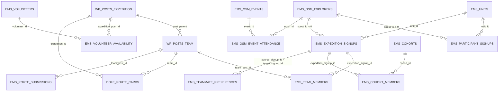

# Data Reference & Contracts

## 1. Entity-Relationship Overview

WordPress custom tables use the `$wpdb->prefix` (`wp_`) and omit SQL `FOREIGN KEY` constraints for `dbDelta` compatibility; referential integrity is maintained by repository and service layers.

---

## 2. Canonical Identity & Join Rules

1. **`expedition_signup_id` + `scout_id` (Unmatched Guest Safety):**
   - `wp_ems_team_members` and `wp_ems_cohort_members` anchor on `expedition_signup_id` so unmatched explorers (`scout_id = 0`) never collide.
   - Repository hydration joins `wp_ems_expedition_signups s` with `LEFT JOIN wp_ems_osm_explorers e ON (s.scout_id > 0 AND s.scout_id = e.scout_id)`.
   - When a sign-up is reconciled/matched to an OSM explorer, `scout_id` propagates atomically to `wp_ems_team_members` via `INNER JOIN wp_ems_expedition_signups s ON s.id = tm.expedition_signup_id`.
2. **WordPress User ↔ OSM `scout_id` (`ExplorerUserResolver`):**
   - `getScoutIdsForUser(userId)` reads `ems_scout_ids` user meta (array of ints), falling back to legacy singular `ems_scout_id`.
   - `getManagedChildScoutIds(userId)` reads `ems_children` user meta.
   - `findWpUserIdByScoutId(scoutId)` queries `wp_usermeta` for serialized `ems_scout_ids` entries, falling back to `ems_scout_id`.
3. **Unit Resolution (`unit_id` / `short_code`):**
   - `wp_ems_units` enforces unique keys on both `unit_id` and `short_code`.
   - Sign-up ingestion and admin lookups resolve units and `leader_email` first by `unit_id`, then by `short_code = %s OR name = %s`.

---

## 3. Custom SQL Tables (16 Active Tables)

### Sign-ups, Explorers & Units

| Table | Primary Key | Key Columns | Indexes |
| :--- | :--- | :--- | :--- |
| **`wp_ems_participant_signups`** | `id` | `scout_id`, `parent_user_id`, `unit_id`, `unit_name`, `explorer_first_name`, `explorer_last_name`, `explorer_email`, `parent_email`, `leader_email`, `dofe_level`, `dob`, `dofe_registered`, `dofe_number`, `dofe_org`, `bronze_completion`, `silver_completion`, `signup_status`, `kanban_stage`, `processing_notes`, `payment_status`, `processed_by`, `processed_at`, `form_submission_id`, `created_at`, `updated_at` | `idx_scout_id`, `idx_parent_user_id`, `idx_unit_id`, `idx_kanban_stage` |
| **`wp_ems_expedition_signups`** | `id` | `scout_id`, `parent_user_id`, `unit_id`, `unit_name`, `explorer_first_name`, `explorer_last_name`, `explorer_email`, `parent_email`, `leader_email`, `dofe_level`, `dob`, `dofe_registered`, `dofe_number`, `expedition_preferences`, `additional_support_needs`, `asn_validated`, `first_aid_status`, `first_aid_expiry`, `signup_status`, `kanban_stage`, `processing_notes`, `participant_place_allocated`, `participant_signup_id`, `form_submission_id`, `created_at`, `updated_at` | `idx_scout_id`, `idx_parent_user_id`, `idx_unit_id`, `idx_kanban_stage` |
| **`wp_ems_osm_explorers`** | `id` | `scout_id`, `wp_user_id`, `section_id`, `first_name`, `last_name`, `email`, `parent_email`, `email1`, `email2`, `p1_email1`, `p1_email2`, `p2_email1`, `p2_email2`, `patrol`, `first_aid_level`, `dofe_number`, `additional_support_needs`, `last_local_update_at`, `last_ems_push_at`, `synced_at` | `UNIQUE idx_scout_id`, `idx_section_id`, `idx_wp_user_id` |
| **`wp_ems_units`** | `id` | `unit_id`, `district`, `name`, `short_code`, `leader_email`, `created_at`, `updated_at` | `UNIQUE idx_unit_id`, `UNIQUE idx_short_code` |

### Expeditions, Cohorts, Teams & Preferences

| Table | Primary Key | Key Columns | Indexes |
| :--- | :--- | :--- | :--- |
| **`wp_ems_cohorts`** | `id` | `name`, `dofe_level`, `transport_mode`, `practice_expedition_id`, `qualifier_expedition_id`, `practice_team_post_id`, `qualifier_team_post_id`, `cohort_status`, `notes`, `created_by`, `created_at`, `updated_at` | `idx_level_mode`, `idx_practice_exp`, `idx_qualifier_exp` |
| **`wp_ems_cohort_members`** | `id` | `cohort_id`, `expedition_signup_id`, `scout_id`, `availability_override`, `member_status`, `practice_team_post_id_override`, `qualifier_team_post_id_override`, `notes`, `added_by`, `created_at`, `updated_at` | `UNIQUE uniq_cohort_signup`, `idx_cohort`, `idx_signup`, `idx_scout` |
| **`wp_ems_team_members`** | `id` | `team_post_id`, `scout_id`, `user_id`, `expedition_signup_id`, `cohort_id`, `availability_override`, `notification_status`, `notified_at`, `notified_by`, `offer_status`, `offer_query_message`, `offer_responded_at`, `offer_responded_by`, `added_by`, `added_at` | `idx_team_post_id`, `idx_scout_id`, `idx_user_id`, `idx_expedition_signup`, `idx_cohort` |
| **`wp_ems_teammate_preferences`** | `id` | `source_signup_id`, `target_signup_id`, `wishlist_hash`, `raw_token`, `unit_hint`, `preference_type`, `match_status`, `confidence_score`, `candidate_ids_json`, `flag_negation`, `reviewed_by`, `reviewed_at`, `created_at`, `updated_at` | `idx_source_signup`, `idx_source_hash`, `idx_target_signup`, `idx_match_status` |

### Volunteers, Routes, OSM Events & Logs

| Table | Primary Key | Key Columns | Indexes |
| :--- | :--- | :--- | :--- |
| **`wp_ems_volunteers`** | `id` | `osm_user_id`, `user_id`, `first_name`, `last_name`, `email`, `phone`, `dbs_number`, `qualifications`, `preferred_roles`, `constraints`, `created_at`, `updated_at` | `idx_email`, `idx_osm_user_id`, `idx_user_id` |
| **`wp_ems_volunteer_availability`** | `id` | `volunteer_id`, `user_id`, `expedition_post_id`, `date`, `overnight`, `confirmed`, `confirmed_by`, `updated_at`, `signup_type` | `idx_volunteer_expedition`, `idx_user_expedition`, `idx_date` |
| **`wp_dofe_route_cards`** | `id` | `expedition_id`, `team_id`, `day_number`, `route_title`, `header_data`, `route_data`, `status`, `approved_by`, `approved_at`, `pdf_file_path`, `created_at`, `updated_at` | `exp_team_day (expedition_id, team_id, day_number)` |
| **`wp_ems_route_submissions`** | `id` | `team_post_id`, `version`, `file_type`, `wp_media_id`, `submitted_by`, `submitted_at`, `feedback`, `status` | `idx_team_post_id` |
| **`wp_ems_osm_events`** | `id` | `event_id`, `section_id`, `name`, `start_date`, `end_date`, `location`, `yes_members`, `yes_leaders`, `no`, `synced_at` | `UNIQUE idx_event_section`, `idx_section_id` |
| **`wp_ems_osm_event_attendance`** | `id` | `event_id`, `scout_id`, `status`, `synced_at` | `UNIQUE idx_event_scout`, `idx_event_id`, `idx_scout_id` |
| **`wp_ems_notification_logs`** | `id` | `template_slug`, `trigger_type`, `recipient_email`, `cc_emails`, `subject`, `target_scout_id`, `target_signup_id`, `target_signup_type`, `target_team_id`, `target_expedition_id`, `dedupe_key`, `status`, `error_message`, `metadata`, `triggered_by`, `sent_at` | `idx_sent_at`, `idx_dedupe_key`, `idx_target_scout`, `idx_template` |
| **`wp_ems_audit_logs`** | `id` | `user_id`, `action`, `target_scout_id`, `ip_address`, `user_agent`, `timestamp` | `idx_user_id`, `idx_target_scout_id` |

### Retired Tables & Legacy Migrations

- **`wp_ems_unit_patrols`:** Retired and ignored during unit table migrations and portability imports.
- **`wp_ems_unit_leaders`:** Explicitly dropped (`DROP TABLE IF EXISTS`).
- **`wp_ems_flexirecord_column_map`:** Retired and completely removed from the codebase.
- **Legacy `season` CPT:** Deprecated; `expedition` posts are detached (`post_parent = 0`), `season` posts deleted, and an `UNALLOCATED` team post is ensured per published `expedition`.
- **Legacy Status Normalization:** `kanban_stage = 'to_process'` migrated to `'new'`; legacy `signup_status` values (`'received'`, `'allocated'`, `'pending'`) migrated to `'submitted'`.

---

## 4. Custom Post Types, User Meta & Options

### Custom Post Types

- **`expedition`** (Labels: `Events` / `Event`, `public => true`, `show_in_rest => true`):
  - Core meta: `ems_level` (`bronze|silver|gold|multiple`), `ems_type` (`training|practice|qualifying`), `ems_transport` (`hillwalking|biking|paddling`), `ems_event_code` (required), `ems_expedition_code`, `ems_start_date`, `ems_start_time`, `ems_end_date`, `ems_end_time`, `ems_route_deadline`, `ems_start_location`, `ems_end_location`, `ems_location_name`, `ems_location_coordinates`, `ems_req_assessors`, `ems_req_volunteers`, `ems_max_teams` / `_ems_max_teams` / `_ems_capacity_teams`.
  - LIC & comms meta: `ems_lic_id`, `ems_lic_name`, `ems_lic_email`, `ems_lic_phone`, `ems_lic_private_email`, `ems_lic_private_phone`, `ems_expedition_lic_name`, `ems_expedition_lic_phone`, `ems_expedition_lic_email`, `ems_expedition_whatsapp_explorers`, `ems_expedition_whatsapp_parents`, `ems_route_info`, `ems_joining_instructions`, `ems_route_days`, `ems_expedition_route_info`, `ems_training_requirements`, `ems_first_aid_level`.
  - Status & OSM meta: `ems_route_received` (`not_received|changes_requested|received`), `ems_route_approved` (`pending|under_review|approved|changes_requested`), `ems_osm_event_id`, `ems_osm_event_url`, `ems_status` (`active|archived`), `ems_route_status` (`draft|confirmed`).
- **`team`** (Labels: `Teams` / `Team`, `public => true`, `show_in_rest => true`, `post_parent` = `expedition` post ID):
  - Meta: `ems_team_code` (required; `'UNALLOCATED'` marks the unallocated pool), `ems_team_number` (`>= 1`, `0` for `UNALLOCATED`), `ems_route_status` (`pending|feedback_required|approved`), `ems_route_feedback`, `ems_gpx_file_id`, `ems_route_card_file_id`, `_ems_team_locked`.

### Key `user_meta` Keys

- Identity & linkage: `ems_scout_ids` (array of ints), `ems_children` (child records/IDs), `ems_scout_id` (legacy singular fallback), `ems_osm_id`, `ems_section_ids`.
- Profile & access: `ems_access_type` (`parent`, `network_member`, `member`, `local`, `leader`), `ems_first_name`, `ems_last_name`, `ems_explorer_email`, `ems_parent_email`, `ems_unit`, `ems_leader_invited_at`, `ems_last_login_at`.
- Transient OAuth sync (admin sync flow): `_ems_osm_token`, `_ems_osm_token_expires`.

### Key `wp_options` Keys

- Policies & Solver: `ems_deadline_policies`, `ems_solver_weights`, `ems_explorer_genders`, `ems_offer_query_email`, `ems_feature_flags`, `ems_page_roles`, `ems_protect_tutor_lms`.
- OSM & Sync: `ems_api_mode`, `ems_api_blocked`, `ems_sync_limit`, `ems_debug_log_guard`, `ems_managed_sections`, `ems_writeback_section_id`, `ems_osm_client_id`, `ems_osm_client_secret`, `ems_osm_auth_url`, `ems_osm_token_url`, `ems_osm_scope`, `ems_osm_api_base_url`, `ems_osm_last_sync`.
- Fluent Forms & Emails: `ems_fluent_participant_form_id`, `ems_fluent_expedition_form_id`, `ems_participant_form_mappings`, `ems_expedition_form_mappings`, `ems_otp_email_*`, `ems_expedition_place_offer_*`, `ems_expedition_offer_acceptance_deadline`, `ems_place_offer_reminder_*`, `ems_leader_invite_email_*`, `ems_leader_dashboard_page_id`.

---

## 5. Entity State Machines & Lifecycles

### `kanban_stage` (`SignupStatusTransitionService`)

- **Participant Sign-ups:** `new` ↔ `on_hold` / `place_allocated` / `cancelled`. Transitioning to `place_allocated` syncs `participant_place_allocated` onto `wp_ems_expedition_signups`.
- **Expedition Sign-ups:** `new` ↔ `team_allocated` / `expedition_completed` / `cancelled` / `withdrawn`.
  - **Protected stages:** `expedition_completed`, `cancelled`, `withdrawn` are never overwritten by automatic team-membership changes.
  - Adding to a real team (excluding `UNALLOCATED`) transitions `new` → `team_allocated`. Removing from a team reverts `team_allocated` → `new` only when active real team memberships drop to `0`.
  - Every transition dispatches `ems.signup.processed` and `ems.signup.status_changed`.

### `signup_status`

- Active records use `'submitted'`; archived records use `'archived'`.

### Team Member Notification & Offer Lifecycle (`wp_ems_team_members`)

- **`notification_status`:** `'draft'` (default / solver output) → `'notified'` (set on batch dispatch; resets `offer_status = 'pending'`) → `'re_notify_needed'` (when team/assignment changes require re-notification).
- **`offer_status`:** `'pending'` (default) → `'accepted'` | `'queried'` | `'declined'`. Administrators can resolve `'queried'` offers back to `'pending'` or `'accepted'`.

### Route Card & Submission Statuses

- **`wp_dofe_route_cards.status`:** `'draft'` → `'submitted'` → `'changes_requested'` | `'approved'` (setting `'approved'` stamps `approved_by` and `approved_at`).
- **`wp_ems_route_submissions.status`:** `'pending'` → `'approved'` | `'rejected'` | `'changes_requested'`.

### Deadline Policies (`ems_deadline_policies`)

- Two policies: `place_offer` and `route_card`, each holding `communicated_date`, `hard_cutoff_date`, and `grace_days` (default `7`).
- `evaluate_cutoff()` enforces `hard_cutoff_date` while granting rolling grace (`allocated_at + grace_days`) whenever that exceeds `hard_cutoff_date`.

### Teammate Preferences & Team Solver

- **`wp_ems_teammate_preferences`:** Stores `preference_type` (`'prefer'` | `'avoid'`) and `match_status` (`'auto_matched'`, `'confirmed'`, `'ambiguous'`, `'cross_bucket'`, `'unit_preference'`, `'not_found'`, `'ignored'`). `wishlist_hash` (MD5 of raw wishlist text) preserves reviewed rows (`confirmed`/`ignored`) unless the source wishlist changes.
- **`TeamSolverService`:** Runs greedy + simulated annealing per `(dofe_level, transport_mode)` bucket (4–7 members per team) to generate in-memory proposals (`propose()`), then persists draft `team` CPTs and `wp_ems_team_members` with `notification_status = 'draft'` (`apply()`), preserving any existing team that contains non-`draft` members.

---

## 6. Shared TypeScript Contracts (`@seee/contracts`)

Defined in `packages/contracts/src/index.ts` and shared across the monorepo:

- **Route Cards:** `RouteContextDTO`, `RouteCardSubmissionDTO`, `ApprovalStatus`.
- **Cohorts & Readiness:** `NotificationStatus`, `MemberResolutionAction`, `DateIntersectionSummary`, `CohortMemberDTO`, `CohortDTO`, `TeamReadinessRowDTO`.
- **Notifications:** `NotificationPreviewRecipientDTO`, `NotificationPreviewDTO`.
- **Teammate Preferences:** `TeammatePreferenceType`, `TeammateMatchStatus`, `ExplorerGender`, `PreferenceCandidateDTO`, `PreferenceTokenDTO`, `PreferenceQueueItemDTO`, `PreferenceQueueResponseDTO`, `PreferenceDecisionItemDTO`.
- **Team Solver:** `SolverWeightsDTO`, `ProposedTeamMemberDTO`, `ProposedTeamDTO`, `ExpeditionCapacitySummaryDTO`, `SolverCompromisesDTO`, `SolverProposalDTO`, `SolverApplyRequestDTO`, `SolverApplyResponseDTO`.
